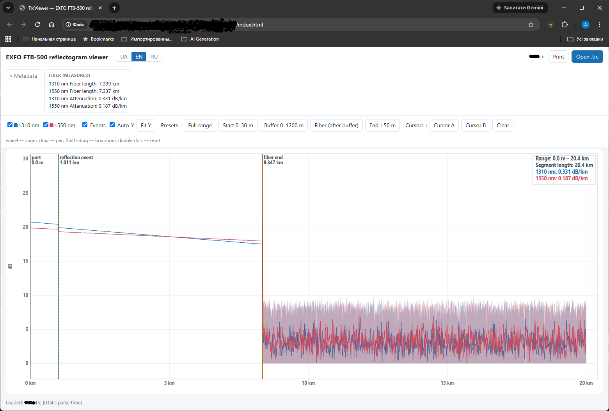

# TrcViewer — просмотрщик рефлектограмм EXFO FTB-500

> English version: [README.md](README.md).

Интерактивный просмотр `.trc` файлов **прямо в браузере**: один статичный
HTML + JS, без сервера, без Node/Python/Excel, работает офлайн.
Формат `.trc` разбирается на JavaScript — это порт формата, документированного
в [FORMAT.md](FORMAT.md); анализатор при этом **не изменяется**.

## Запуск

Двойной клик по `index.html` (или открыть вкладкой в браузере) → перетащить
файл `.trc` на страницу (или кнопка «Открыть .trc»). Поддерживается несколько
волокон в файле — выбор в выпадающем списке шапки.



*Весь диапазон (английский интерфейс): маркеры событий **порт 0 м**, **инжекционное событие
1.011 км**, **конец волокна 8.347 км**, шум за концом волокна, карточка измерения волокна
(длина и дБ/км по каждой длине волны) и оверлей с текущим диапазоном, длиной участка и
затуханием.*

## Возможности

- Обе длины волны (1310/1550 нм) чекбоксами; сырые отсчёты `RawSamples`
  (Int16, 1024 counts/dB). Кривая рисуется тонкой «средней» линией
  постоянной толщины плюс полупрозрачная огибающая min/max по пикселю:
  пики отражений и шум не теряются при уменьшении масштаба, но зум не даёт
  скачков «толстая линия → тонкая» — шум остаётся мягкой подсветкой вокруг
  стабильной средней линии.
- Зум колесом, панорамирование перетаскиванием и горизонтальным колесом
  (тачпад/Firefox), рамочный зум (Shift+drag), двойной клик — сброс;
  авто-Y по видимому окну либо фиксация Y.
  **Y-масштаб стабилен**: ни панорамирование (drag или горизонтальное
  колесо), ни зум колесом Y не меняют вообще. Подгонка по вертикали
  происходит только по явным действиям: загрузка, пресет, рамочный зум
  (Shift+drag), смена видимых длин волн, двойной клик, чекбокс «Авто-Y»
  или кнопка **«Подогнать Y»**. «Авто-Y» выключен — шкала заморожена
  полностью.
- **Устойчивая подгонка Y** (при явных действиях): полоса трассы по
  перцентилям 2–98%, затем в шкалу добавляются пики отражений по краям
  окна (не более +12 дБ сверху и −6 дБ снизу) — пики порта/QC/конца
  влезают в график целиком с небольшим запасом, а ADC-выброс порта
  (±37 дБ) шкалу не растягивает. Шум за концом волокна участвует в шкале
  только когда окно почти целиком — шумовая зона.
- **Одинаковый шаг зума**: колесо нормализуется между браузерами (Firefox
  считает «строками», Chrome — пикселями); один щелчок ≈ ×1.16.
- Маркеры событий EXFO из `EventTable` (порт, отражающие события, конец
  волокна, LMA-секции) с подсказкой: потери, отражения, позиция.
- **Курсоры A/B**: кнопка ставит курсор в центр окна, drag двигает; курсор
  **прилипает к событиям EventTable** в пределах ~12 px (порт, коннекторы,
  конец волокна) — поэтому длина участка между курсорами совпадает с
  карточкой «Волокно (измерения)». Сводка показывает расстояние и уровень
  в A/B, Δdistance, ΔdB и **затухание дБ/км** между курсорами (устойчивой
  оценкой, той же, что в оверлее; сырой ΔdB/Δkm остаётся справочным).
- **Оверлей на графике** (правый верхний угол): для выбранного
  диапазона — курсоры A–B (если заданы) или текущее окно обзора (пресеты,
  зум): границы, **длина участка** и затухание по каждой видимой длине волны. Оценка устойчивая: окно режется по точечным событиям (ступеньки
  коннекторов не искажают наклон), в подсегментах — медианы по ~50 м карманам
  + наименьшие квадраты; стартовая зона порта и шум за концом волокна
  исключаются. На эталонном файле даёт 0.323/0.184 дБ/км на всём диапазоне и
  0.322/0.183 между QC и концом — как GOLD анализатора.
- Пресеты: весь диапазон, старт 0–30 м, буфер 0–1200 м, **волокно (после
  буфера: от QC-коннектора до конца волокна — пресет также автоматически
  ставит курсоры A/B точно на эти границы, поэтому «Длина участка» в оверлее
  совпадает с карточкой «Волокно (измерения)»)**, конец волокна ±50 м.
- Панели над графиком: в одной строке — карточки замера, **карточка
  измерений волокна** (длина участка QC→конец и затухание дБ/км на каждой
  длине волне; длина — по событиям EventTable, затухание — по LMA-секции,
  как GOLD анализатора), **а справа от них сводка курсоров (появляется,
  когда курсоры установлены)**; ниже — контролы/пресеты; график занимает
  остальную высоту страницы; внизу страницы — одна секция: статус загрузки
  и координаты под курсором для всех включённых длин волн. На узком экране
  карточки переносятся на новую строку. Подписи на графике жирные и чуть
  вытянутые по вертикали.
- Мета-карточки: волокно, дата, модуль/серийник, длина спана, потери спана,
  **затухание дБ/км** (по LMA-секции `EventTable`, как GOLD анализатора;
  при отсутствии секции — по наклону сырой кривой), инжекция, ORL,
  RMS шума, число отсчётов.
- Интерфейс UA/EN/RU (переключатель в шапке; по умолчанию — украинский).
- Карточки метаданных (`TrcViewer`, `1310 nm`, `1550 nm`) **сворачиваются влево**
  кнопкой «Метадані» в начале строки карточек; по умолчанию **свёрнуты**
  (выбор запоминается в `localStorage`). Карточка **«Волокно (вимірювання)»** и
  сводка курсоров остаются на экране всегда. Печать передаёт текущее состояние
  окна: свёрнутые метаданные печатаются свёрнутыми (кнопка в PDF скрывается),
  развернутые — развернутыми; при свёрнутых метаданных график в PDF получает
  больше высоты (`PRINT_ASPECT_COLLAPSED = 2.6` вместо `2.9`).
- Кнопка **«Друк»/«Печать»** (`window.print()` — штатный диалог браузера,
  «Сохранить как PDF» без установки чего-либо). В PDF — **текущее состояние
  главного окна**: окно обзора, курсоры A/B, выбранные длины волн, маркеры
  событий, свёрнутость карточек метаданных. Панели управления и подсказки
  скрываются. **Всегда один лист**: макет печати задан только относительными
  величинами (блоки во всю ширину страницы, `body` высотой `min(100vh, 100%)`,
  т.е. не выше страницы, `overflow: hidden`, а график на `flex` забирает весь
  остаток высоты). Фиксированные миллиметры для макета не используются: ширина
  области печати в CSS-пикселах у разных браузеров/драйверов разная (у Firefox
  она оказалась вдвое больше «96 dpi»), и мм-размеры давали или две страницы,
  или мелкий лист на треть страницы.
- Канвас на время печати перерисовывается с фиксированной «печатной» геометрией
  `PRINT_W = 1400` и соотношении сторон, выбранном под реальный блок графика на
  альбомном A4 (`PRINT_ASPECT = 2.9`, при свёрнутых метаданных — `2.6`),
  в разрешении 3× (~300 dpi). Канвас заполняет блок целиком — пустых полос
  сверху и снизу не остаётся, растяжение подписей пренебрежимо малое. Физический
  размер шрифтов/отступов в PDF не зависит от формы окна просмотра. После
  закрытия диалога экран возвращается к обычным размерам.

## Файлы

```
index.html          интерфейс и график (canvas)
otdr-parser.js      парсер .trc (тот же, что использует интерфейс)
tests/selftest.html тесты парсера (открыть в браузере)
docs/screenshot.png снимок графика для README
FORMAT.md           полное описание формата .trc
README.md           English version
```

## Как это работает (кратко)

1. Сканирование файла на zlib-чанки (CMF=0x78, правило RFC 1950), собственный
   inflate (RFC 1950), проверка Adler-32 большого порядка; короткие служебные
   чанки пропускаются, как в анализаторе.
2. Дерево узлов с 16-байтными заголовками, корень `OtdrFile`; обход
   `Fibers → FiberN → Traces → TraceN`.
3. Кривая: blob `RawSamples` (Int16 LE), `level_db = raw / ScaleFactor`,
   `dist_i = (RangeStart + i·SamplingPeriod) · Range / (RangeEnd − RangeStart)`.
4. События: `EventTable` (point/LMA), Status 72 = порт, 0 = отражающее
   событие, 132 = конец волокна; NaN в Double = «значения нет».

## Тесты

Открыть `tests/selftest.html` в браузере: 25 тестов на синтетическом .trc
(zlib round-trip, дерево узлов, RawSamples, EventTable, NaN-политика) плюс
сверка inflate с эталонным `CompressionStream/DecompressionStream` браузера.
Можно выбрать реальный `.trc` и увидеть разобранные события.

Контрольные значения для эталонного `sample.trc` (совпадают с GOLD анализатора;
сами `.trc`-файлы в репозиторий не публикуются):

| Параметр | 1310 nm | 1550 nm |
|---|---|---|
| QC-событие | 1010.93 м (потери 0.541 дБ) | 1010.56 м (0.440 дБ) |
| Конец волокна | 8349.28 м | 8347.10 м |
| Длина подопытного волокна | 7338.4 м | 7336.5 м |
| Затухание (по склону сырой кривой) | 0.321 дБ/км | 0.184 дБ/км |

## Ограничения

- Проверено на файлах OTDR Expert 6.x / FTB-7200D (эталонные сэмплы).
  Файлы других версий прошивки могут не разбираться — парсер честно сообщит
  об ошибке.
- Просмотр и измерение, не редактирование: verdict PASS/FAIL здесь не
  вычисляется (это остаётся у ExfoTrcAnalyzer).
